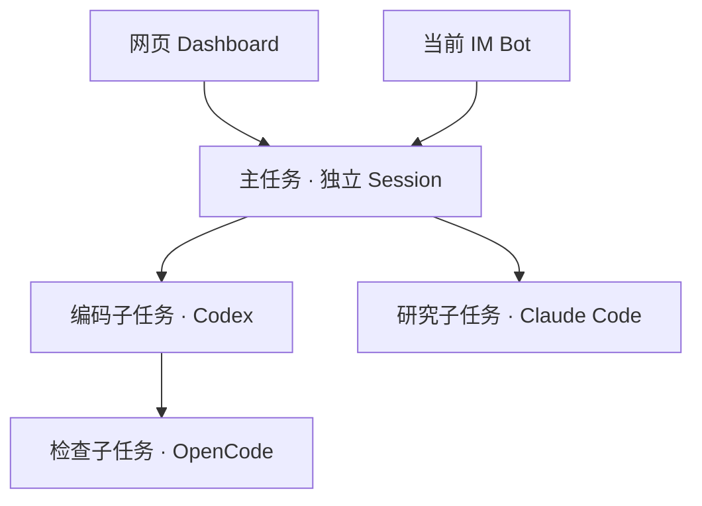

# tab-ai

Every task evolves. Any agent runs it (Codex, OpenCode, Claude Code…); any bot drives it (Feishu, WeCom, DingTalk, WeChat…).

**TAB = Task · Agent · Bot**。tab-ai 在本机运行原生 Agent，把任务组织成树；每个节点拥有独立 Session，可由网页和当前即时通讯入口交替推进。

[安装与第一次使用](docs/installation.md) · [文档导航](docs/index.md) · [设计原则](docs/design-principles.md) · [架构](docs/architecture.md) · [Dashboard](docs/dashboard.md) · [任务编排](docs/task-orchestration.md) · [API](docs/api.md)

## 适合怎样使用

把一个目标拆成可独立推进、验收和交接的任务：例如开发由编码、测试、上线节点接续，研究由资料收集、分析和报告节点协作。每个节点拥有独立 Agent 上下文，父节点统一了解目标、状态和交付摘要；你可以在网页操作，也可以在当前聊天入口接力。

- **网页优先**：统一查看任务树、等待输入的节点、对话、审批、工具记录和交付报告。
- **聊天优先**：在飞书等入口发起任务，用平台支持的卡片、按钮或文字命令处理管理与审批。
- **按节点选 Agent**：Codex、Claude Code、OpenCode 使用各自原生能力，不要求整棵任务树采用同一种 Agent。

## 工作模型

- **Task**：目标、父子关系、依赖、进展、验收与交付。没有子任务也是任务；子任务可以继续拆分。
- **Agent**：Codex、Claude Code、OpenCode。每个任务节点可独立选择执行者，使用各自原生历史和工具能力。
- **Bot**：飞书/Lark、企业微信、钉钉、个人微信的连接实例，负责消息收发与交互。
- **Session**：任务内部的原生对话上下文，保存原生 ID、目录、模型和审批状态。目标完成与会话空闲、关闭分别管理。

Dashboard 保留 **Tasks / Agents / Bots / 总览**。网页与 IM 操作同一个任务及 Session，不复制上下文、不建立第二个执行轮。新子任务默认继承直接父级目录；修改本节点目录不自动迁移已有子节点，共享文件不等于共享对话或具备文件锁。



每个节点都可以继续拆分，也都可以通过网页与其当前 IM 入口操作。图中的 Agent 分配只是示例，不限制任务类型或执行者。

编排任务通过 `task_create` 拆分、`task_progress` 保存阶段进展、`task_report` 提交成果、`task_review` 逐级验收。父会话能看到本分支数量、目标、状态和已提交摘要；完整下级对话保持独立。阶段进度不自动唤醒父任务，空闲与关闭不作为完成依据。

## 快速开始

需要 Node.js **22.16+**，并在运行服务的系统账号下完成所用 Agent 的原生登录。

```sh
npm ci
npm run build
npm start -- init
npm start -- doctor
npm start -- serve
```

另开终端获取网页登录地址：

```sh
npm start -- dashboard
```

只使用网页时，初始化可用 `npm start -- init --local`。之后运行 `npm start -- setup` 或在网页“接入机器人”中添加 Bot。`npm link` 后可直接使用 `tab-ai` 命令。

默认配置为 `~/.tab-ai/config.json`，数据为 `~/.tab-ai/data`。`-c` 可指定其他配置文件，相对目录以该文件所在目录解析。高级配置见 [配置示例](tab-ai.config.example.json)；[环境变量模板](.env.example) 不会自动加载。不要把示例中的工作目录或占位凭证直接用于正式运行。

Dashboard 默认仅监听 `127.0.0.1:4317`，访问令牌保存在数据目录的 `token`。`tab-ai dashboard` 输出含令牌的登录链接；前端读取 fragment 后清除并保存到当前标签页。局域网访问可配置 `dashboardLanHost` 为本机私有 IPv4，远程服务器可使用 SSH 转发。详见 [安装配置](docs/configuration.md) 与 [运行维护](docs/operations.md)。

### 安装包方式

不改源码的使用者可以安装由本仓库构建的 npm tarball：

```sh
npm install --global /path/to/tab-ai-0.3.0.tgz
tab-ai init --local
tab-ai serve
```

另开终端执行 `tab-ai dashboard` 获取网页入口。包包含 CLI、网页、配置模板及使用文档，依赖仍通过 npm 安装。打包、个人安装前缀、独立配置与升级步骤见 [安装指南](docs/installation.md)。

### 第一个任务与接力

在网页 Tasks 新建任务，选 Agent 和真实工作目录，发送一个明确目标；按需处理审批，查看执行记录及交付。接入 Bot 后，可从对应聊天继续同一个 Session。需要分工时从该节点拆分子任务，分别保存目标和验收结果，后续节点可依据已验收报告接续。只查看网页不要求模型登录，真正执行需要相应原生账号和额度。

## 通道能力

| 通道        | 接入与对话                                       | 交互及附件                                                            |
| ----------- | ------------------------------------------------ | --------------------------------------------------------------------- |
| 飞书 / Lark | 扫码或凭证接入；群主会话与独立话题               | 管理卡片、审批/提问、按需下载附件；群模式 mention/context/auto        |
| 企业微信    | 智能机器人 API 长连接；群/单聊与虚拟子会话       | 模板卡片、审批/选择题、图片/文件下载；白名单群可用同 Bot CLI 按需补读 |
| 钉钉        | Stream 接入；群/单聊与虚拟子会话                 | Markdown 管理菜单；审批/提问卡片需租户模板，否则文字兜底              |
| 个人微信    | 扫码登录；文字私聊，引用回复或定向命令进入子会话 | 文字管理和审批；当前不支持微信群与媒体收发                            |

各 Bot 的凭证、授权用户、角色和默认目录独立。全局管理中心只在 Manager Bot 的已授权单聊开放；本会话设置、当前群主会话的下级总览无需 Manager。飞书群的响应模式覆盖群顶层及话题；单聊不需要 @。企微补读不等于未 @ 消息实时订阅。接入步骤与权限见 [首次接入](docs/onboarding.md)、[Bot 与群聊](docs/bot-management.md)、[微信与企微](docs/wechat-wecom.md)。

## 聊天管理

聊天管理统一使用 **`/tab`**，由框架执行；网页对话输入框用于工作请求，管理操作使用工具栏或 API。

| 命令                                       | 用途                              |
| ------------------------------------------ | --------------------------------- |
| `/tab menu` / `/tab status`                | 本会话设置与状态                  |
| `/tab new` / `/tab task 总目标`            | 创建独立节点 / 创建自动编排主任务 |
| `/tab tasks` / `/tab topics`               | 当前任务分支或关联话题总览        |
| `/tab settings` / `/tab workspace 目录`    | 修改本节点模型或目录              |
| `/tab reset` / `/tab compact`              | 重置上下文 / 查看原生压缩面板     |
| `/tab stop` / `/tab close` / `/tab open`   | 停止当前轮 / 关闭 / 恢复          |
| `/tab approval` / `/tab pending`           | 审批策略与待处理请求              |
| `/tab files` / `/tab tools` / `/tab todos` | 附件、工具记录与 Agent 原生待办   |
| `/tab report` / `/tab experience 关键词`   | 交付报告与有来源的经验            |
| `/tab admin`                               | Manager Bot 单聊的全局管理中心    |
| `/tab help`                                | 当前身份可用的完整帮助            |

管理与审批优先使用通道实际支持的卡片或按钮；没有相应控件时提供可复制文字命令。普通消息及附件澄清不附带管理菜单。原生 Agent 若只输出普通文本选项，不会由框架猜测转换成选择题。详见 [会话手册](docs/sessions-guide.md)、[管理菜单](docs/management-cards.md)。

## 交付与经验

关闭 Session、取消任务或提交成果会生成版本化报告：交付产物、接口/研究口径、验证、风险、遗留事项、下一步和有依据的经验。父任务及已声明依赖的下游按报告接续；依赖必须已验收并具有匹配版本的报告，下游才调度。

在 Dashboard 的“交付与经验”查看历史或主动总结。总结使用公开记录与结构化成果；历史截断和生成降级明确标注，不编造验证或经验。经验保留适用条件和来源，不自动写入全局系统提示词。详见 [交付报告](docs/session-reports.md)。

## 原生上下文与权限

Codex 使用 app-server，Claude Code 使用 SDK 原生 preset，OpenCode 使用独立 loopback HTTP/SSE 服务。保留原生登录、项目指令、模型配置与工具权限，按 Session 组合通道背景和显式附加指令。Codex 默认审批策略为 `on-request`，可在本会话选择其他已适配策略；单次/会话内允许按原生请求实际能力展示，不跨 Session 授权。

目录切换保留同一原生 ID；已有历史时仅对明确支持的适配器开放。重置与压缩是不同操作，原生终端交接使用 `tab-ai native <管理ID>`。原生 ID 与框架管理 ID 不可混用。详见 [会话审批](docs/session-approvals.md) 与 [会话管理](docs/session-management.md)。

当前为单机服务：Dashboard bearer 是本机全局管理能力，不提供多租户网页登录；同系统用户和共享目录没有 OS 级隔离。现阶段不提供跨 IM 迁移、自动通道切换或跨 Agent 无损迁移。各平台租户权限、真实客户端交互和原生登录需分别验证。

## 开发与验证

```sh
npm ci
npm run verify
```

verify 一次运行格式、文档、类型、完整测试和构建。`npm test` 限制最多四个测试文件并行，`npm run test:coverage` 提供覆盖率入口。GitHub CI 配置检查 Linux/macOS、Node 22.16.0/24；真实租户联调另行验收。贡献步骤见 [开发指南](CONTRIBUTING.md)，命令、领域和边界见 [测试指南](docs/testing.md)。

构建输出从源码重新生成；格式检查和未使用符号检查防止无用代码积累。文档检查验证仓库内链接。单元/协议测试使用隔离数据与替身，不把通过测试等同于所有真实 IM 租户已验收。验证范围见 [验收](docs/acceptance.md)，功能与限制见 [能力说明](docs/capabilities.md)。

## 文档与支持

| 想完成的事                 | 阅读入口                                                                                                 |
| -------------------------- | -------------------------------------------------------------------------------------------------------- |
| 安装源码或包、第一次启动   | [安装指南](docs/installation.md)                                                                         |
| 接入 Bot 与配置权限        | [接入向导](docs/onboarding.md)、[Bot 管理](docs/bot-management.md)                                       |
| 网页/聊天推动任务和审批    | [Dashboard](docs/dashboard.md)、[会话手册](docs/sessions-guide.md)、[管理菜单](docs/management-cards.md) |
| 理解任务拆分、报告和接续   | [任务编排](docs/task-orchestration.md)、[交付报告](docs/session-reports.md)                              |
| 配置、备份、升级和故障排查 | [配置](docs/configuration.md)、[维护](docs/operations.md)、[排错](docs/troubleshooting.md)               |
| 开发、测试与安全           | [贡献](CONTRIBUTING.md)、[测试](docs/testing.md)、[安全](SECURITY.md)                                    |

项目：[tab-ai ↗](https://github.com/dujl/tab-ai) · [Apache-2.0 许可证](LICENSE)。公开问题请附版本、步骤和脱敏错误；敏感漏洞按安全说明私下报告。
