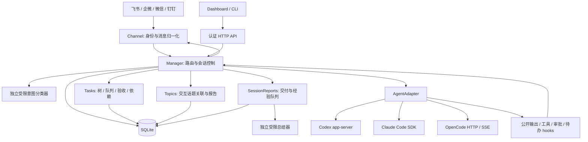

# 当前架构

运行时为一个本机 Node.js 服务，连接多个 Bot 和原生 Agent 运行时。核心原则见 [设计原则](design-principles.md)，存储见 [数据库](database.md)，功能边界见 [能力说明](capabilities.md)。

## 组件

`runtime.ts` 取得数据目录锁，建立 Store、Manager、适配器、连接器与 SetupService，启动认证网页和各独立 Channel。某连接器初始化失败不关闭网页或其他通道。`ready` 表示启动完成，不是持续健康探测。

## 消息与管理路由

1. Channel 从真实事件获取 Bot、发送者、聊天、话题/引用、原文和支持的附件引用。
2. Manager 校验授权、群触发模式和去重；被动群参考不执行命令、模型或下载。
3. `/tab`、明确的关闭/恢复/菜单短语及限定范围的状态/数量查询直接处理。
4. 其他自然语言由独立分类器判断，输入限于当前文本、近期三条用户消息、附件名称和可信能力标记；不恢复工作会话。
5. 决定经 schema、原文与当前绑定验证，进入新节点、任务、附件、群模式、目录、报告或继续工作路径。
6. 分类服务暂不可用时普通工作继续原上下文；涉及管理修改仍要求明确命令。等待 10 秒、冷却 30 秒，不重复向普通工作输出管理识别错误。
7. 工作请求启动/恢复当前 Session；编排输入进入 TaskJob。公开消息按顺序投递，最终结果不重复发送；未知投递不自动重跑 Agent。

分类与总结使用不同受限实例，内部串行、无工具权限。Codex 每次新建 ephemeral thread，Claude 使用不持久化查询。两者使用 `topicRouterAgent`，默认按所选 Agent 推导为 Codex/Claude，不能配置为 OpenCode。

## 统一任务与独立 Session

产品目录由 TaskCatalog 统一投影。TaskRecord 管理目标、root/parent、依赖、结果 revision 与调度能力；Session 管理 nativeId、目录、模型、执行状态和交互。创建中的任务可暂时没有 Session；只交互节点不会因为进入任务表就被自动调度。

Route 的 platform/account/conversation/thread/sender 共同隔离。Binding 选择当前 Session；归档不删除历史。Task.parentId 决定验收层级，根任务 sourceSessionId 只是入口来源。只读分支索引不赋予跨 Bot、聊天或用户的管理能力。

旧数据可在持有服务同一实例锁时全量回填。迁移先备份并在写事务内复核快照，保留原生 ID、历史与绑定，不生成历史执行队列。

## 原生适配

| Agent       | 执行与恢复                                                       | 管理能力                                                      |
| ----------- | ---------------------------------------------------------------- | ------------------------------------------------------------- |
| Codex       | app-server stdio；start/resume 同一 nativeId，turn/start         | 模型/思考、压缩、goal、待办、原生审批；会话授权时保留专属进程 |
| Claude Code | SDK query；原生 preset + user/project/local 配置，resume 原生 ID | 模型、压缩、原生权限规则；待办按实际工具发现                  |
| OpenCode    | 独立 loopback serve，随机认证，HTTP/SSE；按原生 ID 恢复          | 模型、压缩、待办、精确请求范围授权；每轮关闭服务              |

同一 Session 同时只有一个工作/维护轮。原生历史与 app-server 进程是否持续存在是不同维度；默认逐轮恢复不会清空历史，也不保证或否定提供方的 prompt cache 命中。详见 [审批与上下文](session-approvals.md)。

新 Codex 线程注册动态任务工具；恢复的非动态线程与其他后端使用会话专属 loopback MCP，服务身份统一为 `tab_ai_tasks`。端点按 Session 存续，授权只在当前有效轮生效，不暴露 Dashboard token。工具及范围见 [任务编排](task-orchestration.md)。

## 上下文与工作目录

原生指令、可信通道背景、显式会话附加指令组合传入适配器。群参考、任务简报、报告和版本索引作为资料附加；不会复制父/兄弟完整对话，也不输出私有推理。

新节点继承直接父级目录，Agent 可显式选择。当前绑定的空闲节点在无排队输入时可改自身目录；已有历史要求适配器声明支持，目前 Codex/OpenCode 支持，Claude 未开放该迁移。其他节点目录、nativeId 和设置保留；不自动创建 worktree。

## 调度、报告与恢复

Tasks 统一服务聊天、网页和任务工具。持久输入由并发、祖先状态、当前授权、依赖和会话占用共同约束；不同节点可并行，同节点串行。结果先进入 review，由直接父级按 revision 验收。新工作使当前祖先结论失效，历史版本继续留存。

交互话题通过 Topics 保存关联和阶段/最终报告，默认主会话统筹，无开关；编排节点使用 Tasks 的验收和依赖机制。两种内部执行路径都投影为任务，不要求用户切换目录分类。

SessionReports 在关闭、取消、提交成果时整理交付报告与有来源的经验。报告先持久化，等待源轮收尾后生成；下游依赖已验收成果及匹配报告，固定读取版本。生成失败可降级为明确标注的事实摘要，不重跑工作。

重启将运行中 Session/TaskJob 标为中断或待核对；未开始输入可恢复，原生审批不能恢复成有效许可。待生成报告沿用原 ID/版本恢复。Store 构造执行恢复动作，线上只读检查不得另外实例化 Store。

## 权限与平台边界

聊天授权由 Bot allowedUsers、原聊天/用户、当前绑定与动作范围决定。全局管理中心仅 Manager Bot 已授权单聊；本分支只读总览无需 Manager。Dashboard bearer 是本机全局管理能力，不提供多租户 RBAC。

Channel 按实际能力实现话题、下载、卡片、交互和进度。飞书是原生话题，其他通道使用虚拟路由；企微补读是显式白名单的按需 CLI 读取，个人微信仅文字私聊。平台缺权限不会由本地设置或提示词补齐。

文件与原生用户配置可能在同系统账号共享；框架过滤平台凭据，但没有 OS 租户沙箱或自动文件冲突解决。不提供跨 IM 自动迁移。运维与故障处理见 [运行维护](operations.md)。
